

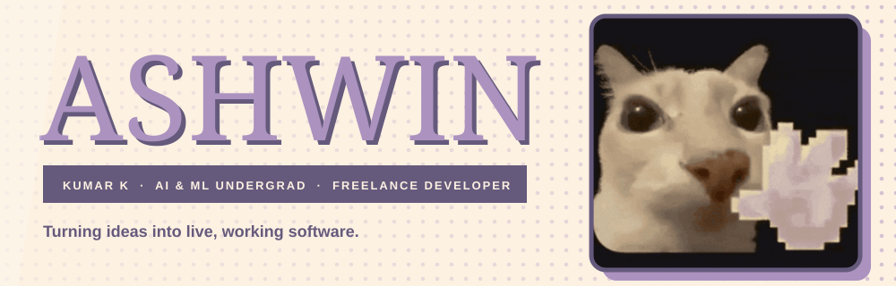
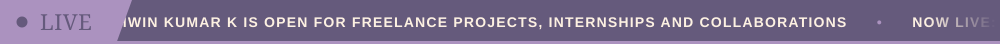

 

 

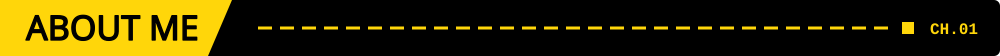

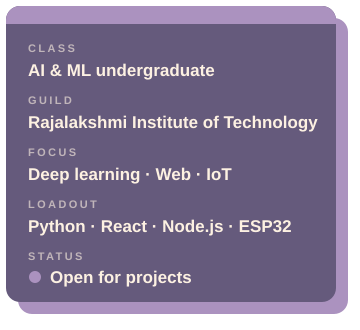

I'm a **Computer Science & Engineering (AI & ML)** undergraduate at **Rajalakshmi Institute of Technology, Chennai**. I love building products that sit where **intelligent software meets the real world**: deep-learning apps, interactive web experiences, and hardware-backed IoT systems.

- 🧠 Developing deep-learning applications with **Python & TensorFlow**
- 🌐 Shipping **live websites** for real users as a frontend developer
- 🔌 Building **IoT and accessibility hardware** with ESP32 and web-based configuration tools, plus an **e-waste collection device** that weighs your e-waste and pays you via UPI
- 💼 **Freelance developer**: I take on projects ranging from live business websites to AI-powered web apps
- 🎯 Interests: **Machine Learning · Deep Learning · IoT · Web Development · UI/UX**

 

 

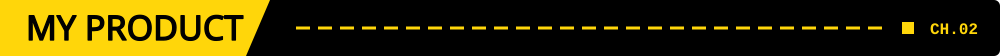

<a href="https://wishsomeoneclosetoyou.netlify.app/">
  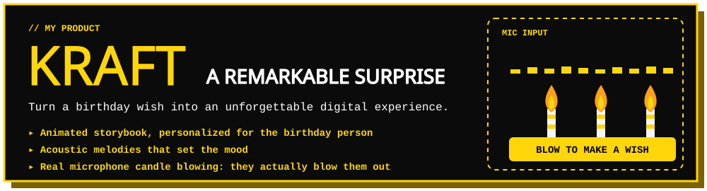
</a>

Turn a birthday wish into something they'll remember: an animated storybook, acoustic melodies, and candles they actually blow out.

 

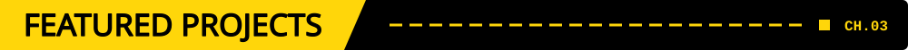

<a href="https://macroboard.netlify.app">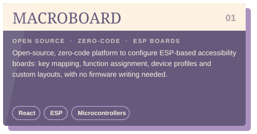</a>
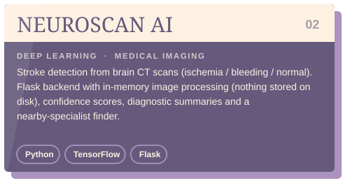
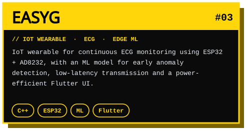
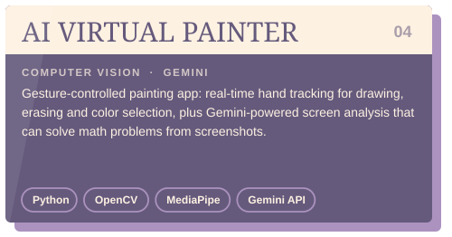

 


A hardware device that collects e-waste, weighs it, and pays the user via UPI based on the weight and the components used inside.

 

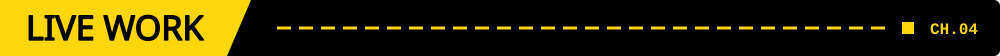

| 📡 Project | Role | Link |
|---|---|---|
| 🏥 **Rhealthcity** (Healthcare Portal) | Frontend Developer, responsive and accessible UI in a 5-member team | [rhealthcity.com](https://www.rhealthcity.com/) |
| 🛍️ **Product Catalog Website** (Plastic Products & Frozen Foods) | Frontend Developer, designed and built a fully responsive live retail catalog | [veera.saicards.in](https://veera.saicards.in/) |
| 🌏 **SaeSpartner** (India Market Entry Consulting) | Developer, built the multi-page corporate website with service and industry pages, a trade enquiry section and a consultation booking form | [saespartner.com](https://saespartner.com/) |

 

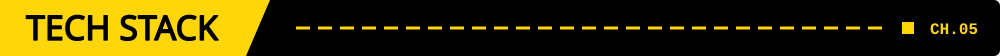

**Languages**

**AI / ML & Computer Vision**

**Web, Backend & Mobile**

**IoT & Hardware**

**Tools & Platforms**

 

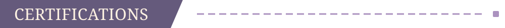

- ☁️ **AWS**: Machine Learning for Natural Language Processing
- 🍃 **MongoDB**: Basics, Developer Track and Aggregation Framework
- 🎖️ Verified professional **digital badge portfolio**

 

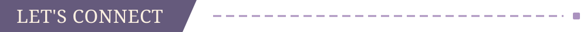

I work as a **freelancer** and I'm open to **freelance projects, internships and collaborations** in AI/ML, web development and IoT. If you have an idea worth building, reach out through my [portfolio](https://ashwinkumark.netlify.app) or [email](mailto:ashwinkumar2k5@gmail.com).

